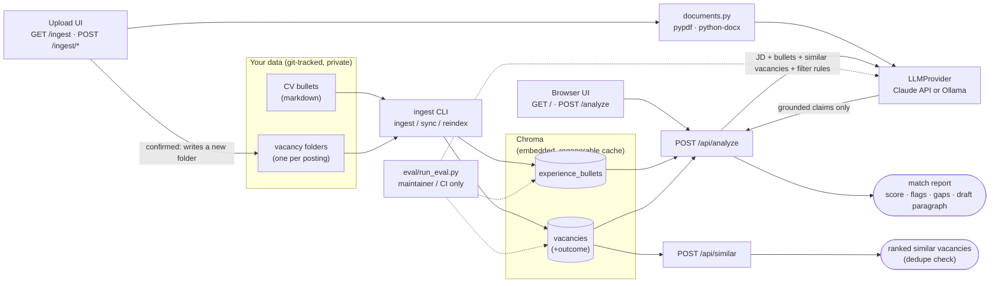

# Vacancy Radar

> Paste a job posting — get a match score against your CV, red/green flags, similar vacancies you've already seen with their outcomes, and a draft opening paragraph grounded in your real experience.

Runs entirely on your own machine, against your own data — clone it, point it at your CV, it's yours.

**Status:** feature-complete for `v0.1.0` — ingestion, `/api/similar`, `/api/analyze`, the eval harness, a minimal browser UI, and vacancy upload (with vision-based drafting for images) are all implemented. See [ROADMAP](#roadmap) below.

## Why

Every job search involves the same manual loop, repeated per vacancy: does this match my experience? Did I see something like it before, and what happened? What should the opening line of my application say? Vacancy Radar automates that loop and keeps a running, queryable history of it.

## Architecture



**Endpoints.** A persistent nav links the two pages below in both directions, so neither
requires already knowing its URL (specs/008-ingest-flow-clarity).
- `GET /` — paste-a-posting UI. Server-rendered (Jinja2 + htmx, no build step) — submits to `POST /analyze` and swaps the rendered report in place. Also accepts uploading a document (image/PDF/DOCX/text, same formats as `/ingest`) instead of pasting text: company/position/date are drafted from it alongside the match report, so the vacancy can be logged right there without a second visit to `/ingest` (specs/009-analyze-and-log-vacancy).
- `GET /ingest` — log-a-vacancy UI. Upload a posting/offer document (image, PDF, DOCX, or plain text); company/position/date are drafted from it for you to review and edit, outcome is always typed by hand, then it's saved and immediately searchable. Each step (upload/review/error/done) is visually distinguished.
- `POST /ingest/draft` / `POST /ingest/confirm` — the two-step upload flow behind the screen above (draft, then review-and-save).
- `POST /api/analyze` — paste JD text. Retrieves matching experience bullets + similar past vacancies with outcomes, returns a structured match report with a draft opening paragraph grounded only in retrieved bullets (citations back to source).
- `POST /api/similar` — dedupe + memory: "you saw almost this vacancy before — applied, rejected for X."
- `GET /healthz` — liveness check.

**Data model.** Each vacancy is a folder (`data/user/vacancies/YYYY-MM-DD_company-slug_position-slug/`), not a flat record — source-of-truth `vacancy.yaml`, plus the actual artifacts of the application (posting snapshots, correspondence, generated analysis). Full schema and reasoning: see the project plan (private, linked from the maintainer's own notes — not included in this public repo).

## Stack

| Choice | Decision | Why |
|---|---|---|
| API | FastAPI | Async-capable, typed, widely requested in relevant job postings |
| Vector DB | Chroma, embedded/persistent mode, via LangChain's `Chroma` vector store | No server to run — a few thousand vectors doesn't need one. Disposable, regenerable cache, never committed — see `specs/010-langchain-integration/research.md` |
| Embeddings | `sentence-transformers` / `BAAI/bge-small-en-v1.5` (local), via LangChain's `HuggingFaceEmbeddings` | Zero cost, no key, reproducible |
| Generation | LangChain `BaseChatModel` — `ChatAnthropic` (Claude) or `ChatOllama` (local) | Claude for quality; Ollama for a fully offline mode; provider-specific request/response handling is the maintained integration's job, not this repo's — see `specs/010-langchain-integration/research.md` |
| UI | Server-rendered Jinja2 + htmx (vendored, no build step) | A one-page paste-and-submit form doesn't need a client-side framework or a second service — see `specs/005-minimal-ui/research.md` |
| Document extraction | `pypdf` / `python-docx` for PDF/DOCX; images are read directly by the configured `LLMProvider`'s vision capability (no local OCR) | Reading a posting/offer document at upload time stays fully local, same as everything else — see `specs/006-vacancy-upload/research.md` and `specs/007-vision-drafting/research.md` |
| Grounding | Citations required on every generated claim | A cover-letter draft that invents an achievement is worse than no draft |

## Quick start

```bash
# bare CLI
pip install -e .
vacancy-radar ingest   # once, to embed CV_DIR/VACANCY_DIR (defaults to data/example)
vacancy-radar serve    # starts the web server on http://localhost:8000

# full stack (any OCI engine — `podman compose` / `podman-compose` work the same)
cp .env.example .env   # fill in ANTHROPIC_API_KEY, or leave it blank to use Ollama
docker compose up --build

# fully offline (adds local Ollama)
docker compose --profile local up --build
```

Point `CV_DIR` / `VACANCY_DIR` in `.env` (or the environment, for the bare CLI) at your own git repo of career data. Nothing personal is baked into the image — see `data/example/` for the sanitized demo set used in this README and in CI. `data/user` is mounted read-write (the app writes a new vacancy folder there when you use the upload screen below); `data/example` stays read-only.

There's no separate provider switch to set: `ANTHROPIC_API_KEY` present means Claude, blank means Ollama (`OLLAMA_MODEL`/`OLLAMA_HOST` both have working defaults).

The container stack is engine-neutral: image names are fully qualified (Podman has no implicit Docker Hub fallback) and bind mounts carry the `z` SELinux label, so `podman compose` on Fedora/RHEL needs no extra flags. `vacancy-radar serve` is also what the container image runs (with `--host 0.0.0.0` so the container is reachable through the port mapping) — no separate `uvicorn` invocation to remember either way. Run bare, it binds to `127.0.0.1` only, since there's no reason to expose it beyond your own machine (`--host`/`--port`/`--reload` are available for local dev). With the full stack running (or after `vacancy-radar serve` bare), open **http://localhost:8000** in a browser — paste a job posting and see your match report. Use **http://localhost:8000/ingest** to log a new vacancy by uploading its posting/offer document instead of hand-editing `vacancy.yaml`.

## Roadmap

- [x] Ingestion CLI (experience bullets + vacancy folders → Chroma, upsert-keyed by natural key)
- [x] `/api/similar` retrieval
- [x] `/api/analyze` full report generation
- [x] Eval harness (grounding check, retrieval recall/MRR, similar-vacancy precision, filter-consistency)
- [x] Minimal UI
- [x] Vacancy upload UI (image/PDF/DOCX/text, vision-based drafting for images)
- [x] `v0.1.0`
- [x] Clear ingest navigation & shared visual style (specs/008-ingest-flow-clarity)
- [x] Analyze and log a vacancy in one pass, from an uploaded document (specs/009-analyze-and-log-vacancy)
- [x] Generation and retrieval migrated to LangChain (specs/010-langchain-integration)

## License

MIT — see [LICENSE](LICENSE).
