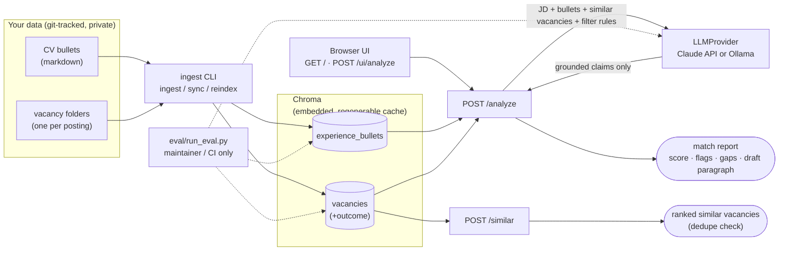

# Vacancy Radar

> Paste a job posting — get a match score against your CV, red/green flags, similar vacancies you've already seen with their outcomes, and a draft opening paragraph grounded in your real experience.

Runs entirely on your own machine, against your own data — clone it, point it at your CV, it's yours.

**Status:** feature-complete for `v0.1.0` — ingestion, `/similar`, `/analyze`, the eval harness, and a minimal browser UI are all implemented. See [ROADMAP](#roadmap) below.

## Why

Every job search involves the same manual loop, repeated per vacancy: does this match my experience? Did I see something like it before, and what happened? What should the opening line of my application say? Vacancy Radar automates that loop and keeps a running, queryable history of it.

## Architecture



**Endpoints**
- `GET /` — paste-a-posting UI. Server-rendered (Jinja2 + htmx, no build step) — submits to `POST /ui/analyze` and swaps the rendered report in place.
- `POST /analyze` — paste JD text. Retrieves matching experience bullets + similar past vacancies with outcomes, returns a structured match report with a draft opening paragraph grounded only in retrieved bullets (citations back to source).
- `POST /ui/analyze` — the HTML counterpart to `POST /analyze`, used by the UI above; same grounded analysis, rendered instead of returned as JSON.
- `POST /similar` — dedupe + memory: "you saw almost this vacancy before — applied, rejected for X."
- `POST /ingest/vacancy` — log a posting + its evolving outcome. *(not yet implemented — CLI ingestion is still the only way in; see [ROADMAP](#roadmap))*
- `GET /healthz` — liveness check.

**Data model.** Each vacancy is a folder (`data/user/vacancies/YYYY-MM-DD_company-slug_position-slug/`), not a flat record — source-of-truth `vacancy.yaml`, plus the actual artifacts of the application (posting snapshots, correspondence, generated analysis). Full schema and reasoning: see the project plan (private, linked from the maintainer's own notes — not included in this public repo).

## Stack

| Choice | Decision | Why |
|---|---|---|
| API | FastAPI | Async-capable, typed, widely requested in relevant job postings |
| Vector DB | Chroma, embedded/persistent mode | No server to run — a few thousand vectors doesn't need one. Disposable, regenerable cache, never committed |
| Embeddings | `sentence-transformers` / `BAAI/bge-small-en-v1.5` (local) | Zero cost, no key, reproducible |
| Generation | Pluggable `LLMProvider` — Claude API or local Ollama | Claude for quality; Ollama for a fully offline mode |
| UI | Server-rendered Jinja2 + htmx (vendored, no build step) | A one-page paste-and-submit form doesn't need a client-side framework or a second service — see `specs/005-minimal-ui/research.md` |
| Grounding | Citations required on every generated claim | A cover-letter draft that invents an achievement is worse than no draft |

## Quick start

```bash
# bare CLI
pip install -e .

# full stack
cp .env.example .env   # fill in ANTHROPIC_API_KEY or set LLM_PROVIDER=ollama
docker compose up --build

# fully offline (adds local Ollama)
docker compose --profile local up --build
```

Point `CV_DIR` / `VACANCY_DIR` in `.env` at your own git repo of career data. Nothing personal is baked into the image — see `data/example/` for the sanitized demo set used in this README and in CI.

Then run `vacancy-radar ingest` once (bare) or exec it inside the running container, and open **http://localhost:8000** in a browser — paste a job posting and see your match report.

## Roadmap

- [x] Ingestion CLI (experience bullets + vacancy folders → Chroma, upsert-keyed by natural key)
- [x] `/similar` retrieval
- [x] `/analyze` full report generation
- [x] Eval harness (grounding check, retrieval recall/MRR, similar-vacancy precision, filter-consistency)
- [x] Minimal UI
- [x] `v0.1.0`

## License

MIT — see [LICENSE](LICENSE).
