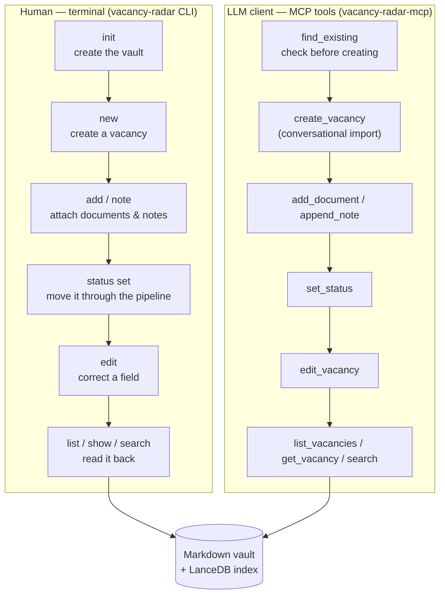

# vacancy-radar

[](https://pypi.org/project/vacancy-radar/)
[](https://pypi.org/project/vacancy-radar/)
[](https://codecov.io/gh/Akay7/vacancy-radar)

A local-first job application tracker. A markdown vault is the source of
truth; a derived LanceDB index provides hybrid BM25 + vector search; an MCP
server exposes read/write tools to any LLM client.

## Why

A job search scatters itself across places that don't talk to each
other: the posting in a browser tab, the recruiter's reply in email, the
take-home in a downloads folder, and a spreadsheet holding the one thing
you thought to write down. The spreadsheet tracks *status* well enough.
It cannot answer "what did I actually tell this company in March?",
because the words never went in it.

vacancy-radar keeps the words. Every vacancy is a directory of plain
markdown — postings, emails, notes, take-homes — with typed frontmatter
for the things worth querying, and a search index derived from all of
it. Three properties follow from that, and they are the point:

- **It's yours, and it's readable.** The vault is markdown files in a
  directory you chose. Grep it, edit it in any editor, put it in git,
  back it up like anything else. The index is derived and disposable —
  delete it and rebuild it any time.
- **It doesn't lose things.** Every write is append-only, a validated
  status transition, or a validated field edit that records what it
  changed. There is no delete command anywhere in the CLI, and no tool
  that discards what you already recorded.
- **An LLM can use it directly.** The MCP server exposes the same
  operations the CLI has, so you can ask your assistant to find the
  thread with a company, file a recruiter's email, or move a vacancy to
  `interview` — and it reads and writes the same markdown you do.

That last one is also how you get an existing tracker in: conversational
import via `find_existing`/`create_vacancy` (see the
[import guide][import-guide]), not an xlsx/CSV importer. This project
ships no spreadsheet parser and no interchange format.

## Quick start

### 1. Install

You need [uv](https://docs.astral.sh/uv/). Nothing else — no clone, no
`uv.lock`.

**macOS / Linux:**

```bash
curl -LsSf https://astral.sh/uv/install.sh | sh   # if you don't have uv
uv tool install vacancy-radar
```

**Windows** (PowerShell):

```powershell
winget install --id=astral-sh.uv -e              # if you don't have uv
uv tool install vacancy-radar
```

That puts both `vacancy-radar` and `vacancy-radar-mcp` on your PATH. To
try it without installing anything permanently, `uvx vacancy-radar
--version` works too.

On Windows, if the commands aren't found afterward, uv installed them to
`%USERPROFILE%\.local\bin` without that being on your PATH. Run `uv tool
update-shell` and open a new terminal.

**Expect the first run to be slow.** The dependency set is large
(`lancedb` and `fastembed` are hundreds of megabytes resolved), and the
first search downloads an embedding model on top of that. Both are
cached afterward — a slow first run is the download, not a hang.

### 2. Create a vault

**macOS / Linux:**

```bash
vacancy-radar init ~/job-search
export VAULT_PATH=~/job-search
```

**Windows** (PowerShell):

```powershell
vacancy-radar init $HOME\job-search
$env:VAULT_PATH = "$HOME\job-search"          # this session only
setx VAULT_PATH "$HOME\job-search"            # persist for new sessions
```

`setx` does not affect the session you run it in, so set both if you
want to keep using the current terminal.

`init` is idempotent — running it again against the same path is a
no-op, not an error — and it never touches anything already in a
directory it adopts, so pointing it at an existing folder is safe.

Every command expects a vault at `VAULT_PATH`, or an explicit path where
the command takes one.

### 3. Connect your MCP client

For Claude Desktop, add this to `claude_desktop_config.json` — on macOS
`~/Library/Application Support/Claude/`, on Windows
`%APPDATA%\Claude\`:

```json
{
  "mcpServers": {
    "vacancy-radar": {
      "command": "vacancy-radar-mcp",
      "args": ["--vault", "/absolute/path/to/job-search"]
    }
  }
}
```

The vault path must be absolute. **On Windows, escape the backslashes**
— JSON treats a lone `\` as an escape character, so
`C:\Users\you\job-search` has to be written
`"C:\\Users\\you\\job-search"` (forward slashes work too, and are
harder to get wrong).

For Claude Code, register it without editing JSON by hand:

```bash
claude mcp add vacancy-radar -- \
    vacancy-radar-mcp --vault /absolute/path/to/job-search
```

On Windows, drop the `\` line continuation and put it on one line.

For [opencode](https://opencode.ai/), add an entry under `mcp` in
`opencode.json` — `~/.config/opencode/opencode.json` (or `.jsonc`) to make it
available in every project, or an `opencode.json` at a project root to
scope it to that project only:

```json
{
  "$schema": "https://opencode.ai/config.json",
  "mcp": {
    "vacancy-radar": {
      "type": "local",
      "command": ["vacancy-radar-mcp", "--vault", "/absolute/path/to/job-search"],
      "enabled": true
    }
  }
}
```

All three assume `uv tool install` from step 1 put `vacancy-radar-mcp`
on PATH. If you would rather not install it persistently, use `uvx` as
the command instead — but note it needs `--from`, because `uvx`
resolves a *distribution* named after the command it is given, and the
script here is `vacancy-radar-mcp` while the distribution is
`vacancy-radar`:

```json
{
  "mcpServers": {
    "vacancy-radar": {
      "command": "uvx",
      "args": [
        "--from", "vacancy-radar",
        "vacancy-radar-mcp",
        "--vault", "/absolute/path/to/job-search"
      ]
    }
  }
}
```

For opencode, that's the `command` array instead:

```json
"command": ["uvx", "--from", "vacancy-radar", "vacancy-radar-mcp", "--vault", "/absolute/path/to/job-search"]
```

A bare `uvx vacancy-radar-mcp` looks for a distribution that does not
exist.

### 4. Start talking to it

Restart the client, and the twelve tools are available. Things worth
saying first:

> I applied to Acme Corp for a Backend Engineer role today, found on
> their careers page. Add it.

> Here's the recruiter's reply *(paste it)* — file it under the Acme
> application.

> What's gone quiet? Show me anything I applied to more than three weeks
> ago with no reply.

> I have an interview with Acme on Thursday. Prep me from what's in the
> vault.

The model calls `find_existing` before creating anything, so telling it
about a vacancy twice does not produce two of them. Everything it writes
lands as markdown in your vault, immediately searchable and readable
without any of this tooling.

Prefer the terminal? The [CLI reference](#cli-reference) below covers
the same operations.

## How CLI and MCP fit together

Two front doors, one back end: a human runs the CLI, an LLM client
calls MCP tools, and both go through the same `core.py` functions onto
the same markdown vault and LanceDB index — neither interface has any
capability, or any data, the other doesn't see.



`init` and `reindex` are CLI-only (see their sections below for why);
everything else on both sides is the same underlying operation,
exposed twice. The CLI trusts the human typing the command; the MCP
tools add the extra checks a model calling them unsupervised needs —
`create_vacancy` never deduplicates on its own (call `find_existing`
first), and every typed error comes back as something the model reads
and can act on in the same turn, not a crash.

## CLI reference

Examples below are written for an installed tool. Working from a clone,
prefix each one with `uv run`.

### Reading

`list`, `show`, `search`, and `doctor` are read-only: they never write to
the vault or the index. Every command prints a Rich table for humans by
default; add `--json` for a machine-readable, stable, documented shape
suitable for piping.

```bash
# List vacancies, optionally filtered (--status, --company, --since,
# --needs-review, --stale-days, --resume), sorted by last activity.
vacancy-radar list --status applied --status interview

# Compare resume variants (an A/B test of your resumes): for each
# --resume label, how many applications used it and how they stand now.
# Counts only vacancies already applied to. "advanced" means currently
# screening / take_home / interview / offer - an application rejected
# after an interview counts as rejected. Rates come from current status
# and small counts are noise, so compare variants sent to comparable
# roles and read the counts, not just the percentage.
vacancy-radar resumes --since 2026-01-01

# Show one vacancy or company - which kind it is is auto-detected.
vacancy-radar show acme-corp

# Search the vault's index (see "Retrieval evaluation" below);
# --scores prints each hit's keyword/semantic rank and fused score.
vacancy-radar search "backend engineer" --scores

# Report vault and index health: marker, index freshness, embedding
# model availability, and every warning collected while reading.
vacancy-radar doctor
```

### Writing

`note`, `status set`, `edit`, `add`, `new`, and `reindex` write to the
vault. Every write is append-only, a validated status transition, or a
validated field edit that records what it changed in the vacancy's own
edit history - nothing here deletes existing content, and there is no
delete command anywhere in the CLI. `note`, `status set`, `edit`, and `add` accept a vacancy by id, company
slug, company name, or unambiguous fuzzy match - a company argument
resolves to that company's vacancy when it has exactly one. Anything
that can't be narrowed to a single vacancy - a name matching two
companies, or a company holding two vacancies - prints what it matched
and exits non-zero without writing anything. `--json` follows the same
stable, documented-shape convention as the read commands above.

```bash
# A vacancy argument is an id, a company name/slug (when that company
# has exactly one vacancy), or an unambiguous fuzzy match. A company
# with several vacancies needs the vacancy id - the error names every
# candidate id, so the fix is to paste one of them.

# Append a dated note. The filename is always derived from the date -
# never something you (or an LLM) supply.
vacancy-radar note 2022-03-22-acme-corp-backend-engineer \
    "Called the recruiter, no news yet."

# Move a vacancy's status. Backward transitions need --force; the first
# move off 'found' needs --applied-date.
vacancy-radar status set 2022-03-22-acme-corp-backend-engineer \
    applied --applied-date 2026-01-15

# Record which resume variant you applied with (any short label, e.g.
# "backend-v2"). Also accepted by `new` and `edit` (`--clear resume`
# removes it). Labels compare case-insensitively.
vacancy-radar status set 2022-03-22-acme-corp-backend-engineer \
    applied --applied-date 2026-01-15 --resume backend-v2
vacancy-radar status set 2022-03-22-acme-corp-backend-engineer \
    found --force

# Correct a vacancy's stored fields - a posting URL that moved, a role
# captured as "unknown", a mistyped date. One option per editable
# field; several can change in one call. Every applied change is
# appended to the vacancy's "## Edit History" block.
vacancy-radar edit 2022-03-22-acme-corp-backend-engineer \
    --source-url https://acme.example/careers/backend \
    --role "Senior Backend Engineer"

# Remove a field with --clear (repeatable). Only the nullable fields can
# be cleared: source-url, stage-note, salary-note, recruiter,
# external-id, applied-date, resume.
vacancy-radar edit 2022-03-22-acme-corp-backend-engineer \
    --clear recruiter --clear salary-note

# --tags replaces the whole list rather than appending to it; --tags ""
# empties it. Status is not editable here - `status set` owns it, so a
# transition is always validated against the status graph. A vacancy's
# company and id cannot be changed at all.
vacancy-radar edit 2022-03-22-acme-corp-backend-engineer --tags "remote,python"

# File a *text* document (posting, email, note, or takehome) from a
# file or stdin. --external-id makes re-filing the same source (e.g.
# the same email thread) a no-op instead of a duplicate. `--file`/
# `--stdin` read UTF-8 text - binary content (a PDF) fails with a
# clear error naming the alternative below, not a crash.
vacancy-radar add 2022-03-22-acme-corp-backend-engineer \
    --kind email --title "Recruiter reply" --date 2026-01-16 \
    --external-id gmail-thread-42 --stdin < email.txt

# Create a new vacancy (and its company directory, if new). --url is
# optional - omit it when the source has no link at all (e.g. a
# recruiter sent only a PDF attachment).
vacancy-radar new --company "Acme Corp" --role "Backend Engineer" \
    --url https://jobs.acme.example/1 --found-date 2026-01-10

# Rebuild the index from the vault's current state. Not required for
# ordinary use - every write above already reindexes its own effect
# eagerly, before returning, so it's searchable immediately.
vacancy-radar reindex

# Extract text from any PDF under documents/ into a git-tracked
# <filename>.pdf.md sidecar, so it's searchable by content, not only
# by filename. Off by default - a build never silently creates sidecar
# files; pass this explicitly whenever a PDF was added or changed.
vacancy-radar reindex --extract-sidecars
```

### Attaching a PDF

There is no CLI command for filing a PDF the way `add` files text -
copy it directly into the vacancy's `documents/` directory, then
reindex with extraction:

**macOS / Linux:**

```bash
cp ~/Downloads/posting.pdf \
    ~/job-search/acme-corp/2022-03-22-acme-corp-backend-engineer/documents/
vacancy-radar reindex --extract-sidecars
```

**Windows** (PowerShell):

```powershell
Copy-Item $HOME\Downloads\posting.pdf `
    $HOME\job-search\acme-corp\2022-03-22-acme-corp-backend-engineer\documents\
vacancy-radar reindex --extract-sidecars
```

This registers the PDF as a document (`kind: takehome`, `title` set to
the filename, `date` set to the vacancy's `found_date` - none
independently settable this way; a posting or interview-prep PDF is
filed the same way, just under that `kind`) and writes a
`<filename>.pdf.md` sidecar containing its extracted text, so it's
searchable by content afterward. An encrypted or unparseable PDF fails
extraction without crashing the reindex - a warning naming the file
prints in `reindex`'s output (and appears under `--json`'s `warnings`
field too).

## MCP server reference

`vacancy-radar-mcp` exposes the same `core.py` functions the CLI calls,
as MCP tools/resources/prompts over stdio, for any MCP client (Claude
Desktop, etc.). [Quick start](#3-connect-your-mcp-client) covers wiring
it into a client.

**Vault path**: `--vault` if given, else the `VAULT_PATH` environment
variable; neither present fails startup naming both. MCP's client-
supplied-roots capability is deliberately not used here - it is
deprecated as of the protocol revision the MCP Python SDK speaks by
default (2026-07-28, SEP-2577), so `--vault`/`VAULT_PATH` are the only
two ways to point the server at a vault, exactly like configuring any
other stdio MCP server.

**Thirteen tools**, matching `core.py`'s functions one for one - argument
marshalling only, no filtering/sorting/business logic of its own:

| tool | delegates to |
| ---- | ------------- |
| `list_vacancies` | `core.list_vacancies` |
| `get_company` | `core.get_company` |
| `get_vacancy` | `core.get_vacancy` |
| `search` | `core.search` |
| `read_document` | `core.read_document` |
| `resolve` | `core.resolve` |
| `find_existing` | `core.find_existing` |
| `resume_stats` | `core.resume_stats` |
| `append_note` | `core.append_note` |
| `set_status` | `core.set_status` |
| `edit_vacancy` | `core.edit_vacancy` |
| `add_document` | `core.add_document` |
| `create_vacancy` | `core.create_vacancy` |

`reindex` is deliberately **not** exposed - every write tool already
refreshes the index itself, and there's no legitimate reason for a
client-connected model to trigger a full rebuild.
`create_vacancy` *is* exposed, for conversational import
(see the [import guide][import-guide]): it does not deduplicate, so its
own tool description tells a calling model to call `find_existing` first
and only create when that returns no match. `search`'s description tells
the model to prefer `mode="keyword"` for exact-name/proper-noun queries
and leave `mode` unset (hybrid) otherwise, citing the measured numbers
in "Retrieval evaluation" below - without that guidance a model defaults
to hybrid for everything and the per-category tuning goes unused. A
typed `core.py` error (an ambiguous match, an invalid status transition,
a nonexistent vacancy) surfaces as a structured tool result the calling
model can read and act on, never a raw crash.

**Two resources**: `vacancy-radar://companies` (every company's slug,
display name, and vacancy count) and `vacancy-radar://statuses` (every
status and the transitions permitted from it, read live from
`models.py`).

**Three prompts**: `prep_interview(company)` (dossier, postings, prior
notes, take-homes), `draft_reply(vacancy_id)` (prior correspondence, to
match tone), and `weekly_review()` (stale applications, pending
take-homes, vacancies tagged `needs_review`). An unresolved or
ambiguous `company`/`vacancy_id` returns a message saying so - never a
fabricated dossier.

**Inline views (MCP Apps).** The server registers the
`io.modelcontextprotocol/ui` extension, so a host that supports it
renders `list_vacancies`, `get_vacancy`, `get_company`, and `search`
results as a compact card or table instead of raw JSON. The views are
static, self-contained HTML with no network access; they render only
the fields already in the tool's result. Nothing to configure, and a
client that doesn't support the extension sees exactly the same text
output as before.

## Working on the code

From a clone:

```bash
uv sync --all-groups
```

Every CLI example above then needs a `uv run` prefix — `uv run
vacancy-radar list`. The MCP server runs the same way:

```bash
uv run vacancy-radar-mcp --vault /path/to/vault
```

Tests and lint:

```bash
uv run pytest
uv run ruff check .
uv run ruff format --check .
```

CI runs these on Linux only. The code is written to be
platform-independent — `pathlib` throughout, every text read and write
pinned to UTF-8 rather than the platform default — but macOS and Windows
are not covered by automated tests, so please report anything
platform-specific you hit.

Install the git hooks once per clone, so lint/format issues are caught
before you commit (the same checks CI runs):

```bash
uv run pre-commit install
```

Run them on demand against all files with `uv run pre-commit run
--all-files`.

Releases are cut by pushing a `vX.Y.Z` tag; see
[docs/releasing.md][releasing] for the procedure and the one-time
publishing setup.

## Retrieval evaluation

Measured with `eval/`'s harness: 30 labelled queries (`eval/queries.yaml`,
across seven categories) run against the committed fixture vault
(`tests/fixtures/vault/`), scored with `recall_at_k`/`mrr` over each
mode's top 5 results. Reproduce it from a clone with `uv run
vacancy-radar eval`.

**Overall, by mode:**

| mode | vector_weight | fusion | recall@5 | MRR |
| ---- | -------------- | ------------------- | -------- | ----- |
| keyword | — | — | 0.761 | 0.675 |
| semantic | — | — | 0.678 | 0.583 |
| hybrid | 0.5 | rrf | 0.672 | 0.541 |
| hybrid (**shipped default**) | 0.5 | linear_combination | 0.794 | 0.687 |

**Per category, keyword vs. semantic vs. the shipped hybrid default (recall@5):**

| category | keyword | semantic | hybrid (0.5, linear_combination) |
| ------------ | ----- | ----- | ----- |
| exact_name | 1.000 | 0.800 | 1.000 |
| technical | 0.800 | 0.800 | 1.000 |
| paraphrase | 0.250 | 0.750 | 0.250 |
| temporal | 1.000 | 0.250 | 1.000 |
| multi_result | 0.417 | 0.250 | 0.417 |
| filtered | 0.792 | 0.833 | 0.792 |
| negative | 1.000 | 1.000 | 1.000 |
| **overall** | **0.761** | **0.678** | **0.794** |

Keyword dominates `exact_name` (company/recruiter proper nouns) exactly
as the retrieval design predicted, and semantic strictly dominates `paraphrase`
(queries sharing no content word with their target) — the one category
keyword structurally cannot serve at all. Both single modes are weak on
`multi_result` and one of them is weak on `temporal`, which top-5
recall@5 punishes when several correct documents compete for five
slots. **The fusion strategy default did not survive contact with
measurement**: RRF (the original default) *underperforms plain
keyword search* on this corpus — 0.672 vs. 0.761 overall recall@5,
identical across every `vector_weight` since RRF is rank-based and
weight-agnostic — while Linear Combination fusion at `vector_weight`
0.3–0.6 ties for the best result on every metric checked (0.3–0.6 score
identically; 0.7 ties on recall@5 but drops on MRR). `default_vector_weight`
is set to `0.5`, the middle of that tied band, and `fusion_strategy` to
`LINEAR_COMBINATION` — both a reversal of the original guess, not a
confirmation of it. See `config.py`'s `SearchConfig` docstring for the
tuning rationale behind the shipped values.

**Limitations.** These numbers characterize the retrieval *design*
against a synthetic, generator-produced fixture vault — not a real
corpus of job-search correspondence. `tests/fixtures/generate.py`'s
proper nouns, phrasing patterns, and document lengths are artifacts of
the generator, not a sample of real vacancies, emails, or notes. Treat
this table as justification for a *default*, not a claim that
generalizes. See [docs/evaluation.md][evaluation] for the
procedure to run a second eval against your own real vault after
import, and for which numbers to trust when retuning
`SEARCH_DEFAULT_VECTOR_WEIGHT`/`SEARCH_FUSION_STRATEGY` for your own
deployment.

**Future work, not built yet.** `multi_result` and `temporal` recall
suggest a reranker could help beyond what fusion-weight tuning alone
achieves. Whether `negative`-category queries should return a
score-floor-suppressed empty result instead of five low-relevance ones
is a real product question, deliberately left open: it would change
`search()`'s return contract, and it is worth doing only if a real
vault's negative-query scores turn out close enough to real hits to
mislead.

## License

MIT — see [LICENSE][license].

[import-guide]: https://github.com/Akay7/vacancy-radar/blob/main/docs/import-guide.md
[evaluation]: https://github.com/Akay7/vacancy-radar/blob/main/docs/evaluation.md
[releasing]: https://github.com/Akay7/vacancy-radar/blob/main/docs/releasing.md
[license]: https://github.com/Akay7/vacancy-radar/blob/main/LICENSE
